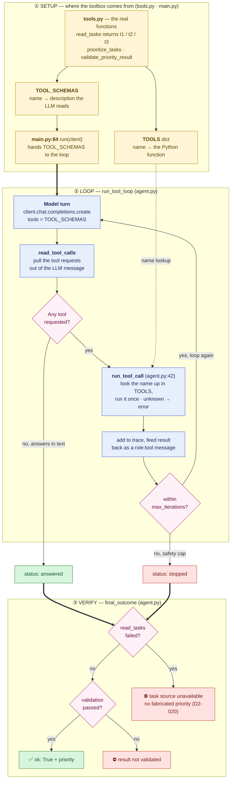

# `agent.py` — function flow diagram

The whole "what should I do first?" run, in three phases: **① Setup** (where the
toolbox comes from), **② Loop** (the LLM → tool → LLM round), **③ Verify** (how a
result becomes a trustworthy answer). Read it top to bottom.

## How to read it

**① Setup — where the toolbox comes from** (yellow)
- `tools.py` holds the real functions. `read_tasks` is where the task strings
  (t1/t2/t3) physically live — the LLM never sees this code.
- Each tool has two name bindings: `TOOL_SCHEMAS` (name → the description the
  LLM reads, so it knows *when* to ask) and `TOOLS` (name → the Python function,
  so we can *run* what it asked for).
- `main.py:84` hands `TOOL_SCHEMAS` to the loop (thick arrow into ②). That is
  the moment the toolbox is handed over.

**② Loop — `run_tool_loop`** (blue, with pink decisions)
1. The LLM takes a turn with the schemas as `tools`.
2. `read_tool_calls` extracts any tool requests.
3. No tool → `status: answered`. Tool → `run_tool_call` looks the name up in
   `TOOLS` (dotted arrow from ①), runs it once, feeds the result back.
4. Loop again until the model answers, or `max_iterations` stops it →
   `status: stopped` (the safety cap).

**③ Verify — `final_outcome`** (green = good, red = honest refusal)
- `read_tasks` failed → ⛔ no priority at all, never a fabricated one (D2-020).
- validation (`validate_priority_result`) did not pass → ⛔.
- validation passed → ✅ the verified priority is returned.

**One-line summary:** the task strings are born in `tools.py`, the tool names are
handed to the LLM by `main.py`, the real call happens at `agent.py:42`, and no
answer is shown unless `final_outcome` verified it.

> `build_tool_result_message` (not drawn) does the same "run + wrap as role:tool"
> work as steps **run_tool_call + feed** combined; the loop does it inline instead.
