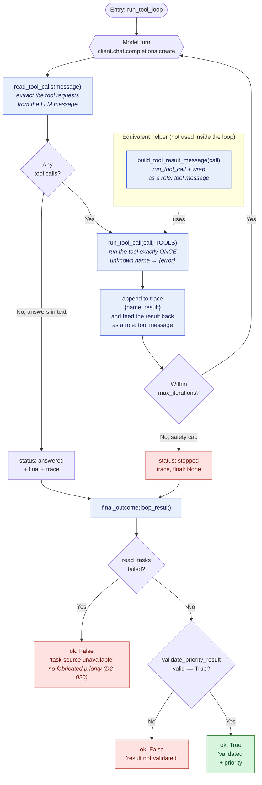

# `agent.py` — function flow diagram

How the functions in `agent.py` call each other and how data flows through
the LLM → tool → LLM round. Read top to bottom: it describes one full run.

## Reading the diagram

**The loop** (`run_tool_loop`)
1. The LLM takes a turn → `read_tool_calls` extracts any tool requests.
2. No tool requested → `status: answered`. Tools requested → `run_tool_call`
   runs each tool **once** (unknown name = `{error}`, never a crash).
3. The result goes into the `trace` and is fed back to the LLM as a
   `role: tool` message.
4. Repeat until the model answers, or `max_iterations` cuts the round →
   `status: stopped` (the safety cap).

**The verification** (`final_outcome`), the three outcomes in colour:
- 🟥 `read_tasks` failed → `ok: False`, no fabricated priority (D2-020).
- 🟥 validation did not pass → `ok: False`.
- 🟩 `validate_priority_result` valid → `ok: True` + priority.

`build_tool_result_message` does the same "run + wrap as `role: tool`" work,
but it is not used inside the loop (there the step is done inline).
